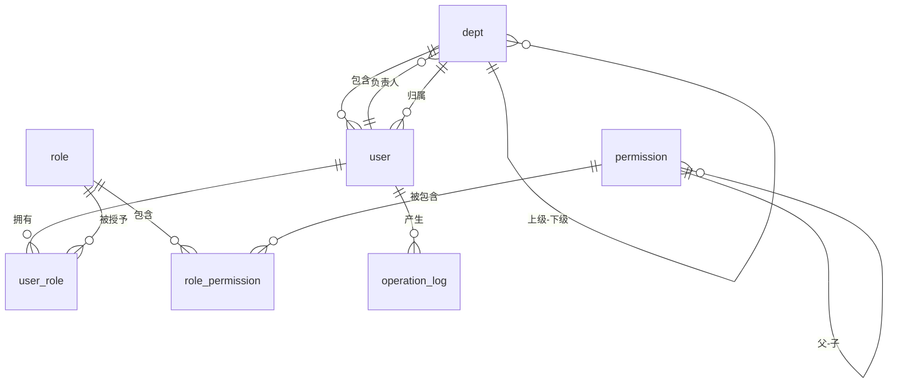

# 基于工业软件企业后台管理系统数字化运营的数据库设计说明书

工业软件开发综合实训（课程代码 192434303）· 数据库名 industrial_admin · MySQL 8.0 · 文档版本 V1.0

## 1  概述

### 1.1  编制目的与范围

本文档依据工业软件开发综合实训任务书与指导书，为“基于工业软件企业后台管理系统数字化运营”设计 MySQL 8.0 数据库，库名 industrial_admin。文档覆盖概念模型（E-R）、逻辑模型（关系模式与范式）、物理模型（建表与索引）、安全设计、事务与初始化数据六个部分，并配套一份可直接执行的建库建表脚本，作为编码阶段的唯一数据源依据。

范围限于本次实训建成的六个业务模块所需的数据结构：登录与用户管理、角色与权限（RBAC）、部门与组织架构、系统参数配置、运营数据看板、操作日志。不包含外部客户账号、岗位职级、数据行级权限与日志归档等后续迭代内容，与《需求分析与概要设计》第 1.2 节的边界一致。

### 1.2  设计依据与环境

设计依据为实训任务书对数据库的四条要求：包含用户、角色、权限、用户角色关联、部门、系统配置、操作日志等核心表；表结构满足第三范式基本要求、关键字段设置约束；所有数据库操作使用参数化或预编译方式；涉及用户创建、角色授权等一致性操作使用事务。在此基础上补充角色权限关联表，否则 RBAC 的三级授权无法闭合。

运行环境为 MySQL 8.0，存储引擎 InnoDB，字符集 utf8mb4，排序规则 utf8mb4_0900_ai_ci，时区 Asia/Shanghai。选择 InnoDB 是为获得事务与行级锁；选择 utf8mb4 是为完整支持中文与四字节字符。需要特别提示：role 在 MySQL 8.0 中是保留字，建表与查询必须写作反引号包裹的标识符，脚本中已统一处理。

### 1.3  命名与字段规范

统一命名可以减少联调阶段的理解成本，也便于用脚本批量生成代码。全库遵循表1 的规范。

**表1  命名与字段规范**

| 对象 | 规则 | 示例 |
| :--- | :--- | :--- |
| 库名 | 小写下划线，不与系统库重名 | industrial_admin |
| 表名 | 小写下划线，单数名词，不加业务前缀（保留字加反引号） | user、role、permission、operation_log |
| 字段名 | 小写下划线，布尔用 is_ 前缀，时间用 _at 结尾 | is_builtin、created_at、deleted_at |
| 主键 | 统一 BIGINT UNSIGNED 自增 | id |
| 外键 | fk_子表_父表，索引 idx_表_字段，唯一 uk_表_字段 | fk_user_dept、idx_log_module_time |
| 状态字段 | TINYINT，1 表示启用/成功，0 表示停用/失败 | status、result |
| 时间字段 | DATETIME，业务表必有 created_at 与 updated_at | updated_at ON UPDATE CURRENT_TIMESTAMP |
| 软删除 | 业务表使用 deleted_at，NULL 表示未删除 | deleted_at |

### 1.4  设计原则

设计遵循五条原则。一是字段最小化，表中不保存可由其他字段推导的信息，角色名称、部门名称不冗余到用户表；二是约束前置，能在数据库层约束的（唯一、外键、非空、默认值）都落到表结构，业务层只做补充校验；三是可追溯，所有业务表带创建与更新时间，删除使用软删除标记；四是日志独立，操作日志表只追加、不更新、不软删除，避免审计记录被业务逻辑改写；五是可演进，表名与字段名保持业务中性，后续加模块只需新增表，不改动既有结构。

## 2  概念模型设计

### 2.1  实体与属性

系统抽象出八个实体，其中六个构成 RBAC 的核心，两个承担配置与审计职责。实体与表的对应关系见表2，每个实体的属性即物理表中的业务字段，主键统一为自增整型，审计字段（创建时间、更新时间、软删除时间）不属于业务属性、不参与范式判断。

**表2  实体清单**

| 实体 | 对应表 | 职责 | 主要属性 |
| :--- | :--- | :--- | :--- |
| 部门 | dept | 组织架构与归属分组 | 部门名称、编码、上级、负责人 |
| 用户 | user | 身份载体，账号与口令 | 账号、口令哈希、姓名、部门、状态 |
| 角色 | role | 授权管理单元 | 角色编码、名称、数据范围 |
| 权限点 | permission | 授权最小粒度 | 权限编码、类型、路由、接口 |
| 用户角色 | user_role | 用户与角色的关联 | 用户、角色、授予时间 |
| 角色权限 | role_permission | 角色与权限的关联 | 角色、权限、授权时间 |
| 系统配置 | sys_config | 运行期可调参数 | 键、值、类型、分类 |
| 操作日志 | operation_log | 审计留痕 | 操作人、模块、动作、结果、耗时 |

实体之间存在两类特殊结构：部门与权限点都是自关联的树，用上级标识表达层级，而不是用“一级部门、二级部门”之类的多个字段；用户与角色、角色与权限都是多对多，必须通过关联表连接，不能在主表里存逗号分隔的标识列表。

### 2.2  联系与基数

八个实体共形成八组联系，基数与语义见表3。其中“包含（部门对用户）”限定为一个用户只属于一个主部门，这样按部门统计时不会重复计数；如需兼职多部门，应另建用户部门关联表，而不是在用户表里放多个部门。

**表3  联系与基数**

| 联系 | 两端实体 | 基数 | 说明 |
| :--- | :--- | :--: | :--- |
| 上下级 | dept — dept | 1:N | 通过 parent_id 自关联，根部门 parent_id 为 NULL |
| 包含 | dept — user | 1:N | 一个部门有多个用户，一个用户只属一个主部门 |
| 负责 | user — dept | 1:N | 一个用户可负责多个部门，部门负责人可为空 |
| 拥有 | user — role | M:N | 经 user_role 连接，多角色权限取并集 |
| 包含 | role — permission | M:N | 经 role_permission 连接，授权的最小粒度 |
| 父子 | permission — permission | 1:N | 菜单下的子菜单、按钮与接口权限点 |
| 产生 | user — operation_log | 1:N | 一条操作日志对应一个操作人 |
| 独立 | sys_config | — | 键值对独立实体，与其他表无联系 |

“产生（用户对日志）”刻意不建物理外键：日志写入频次远高于业务表，外键校验会带来额外锁与索引开销，且用户被删除后历史日志仍需保留，因此日志只记录用户标识与账号快照。

### 2.3  E-R 图文字描述

图1 以缩进树形式描述 E-R 图，可直接作为报告中的 E-R 图绘制依据：第一层为实体，第二层为该实体发出的联系，标注基数与关联字段。

```text
工业后台管理系统（industrial_admin）
├── dept 部门
│     ├─ 1:N  自关联（parent_id）      上级部门 → 下级部门，形成组织树
│     ├─ 1:N  包含 user（dept_id）     一个部门拥有多个用户
│     └─ N:1  负责人（leader_id）      部门 → 用户，可为空
├── user 用户
│     ├─ N:1  归属 dept（dept_id）     一个用户属于一个主部门
│     ├─ M:N  拥有 role                经关联表 user_role 连接
│     └─ 1:N  产生 operation_log       逻辑关联（记录 user_id 快照），不建物理外键
├── role 角色
│     ├─ M:N  授予 user                经关联表 user_role 连接
│     └─ M:N  包含 permission          经关联表 role_permission 连接
├── permission 权限点
│     ├─ 1:N  自关联（parent_id）      菜单 → 子菜单 → 按钮 / 接口
│     └─ M:N  被 role 包含             经关联表 role_permission 连接
├── sys_config 系统配置                独立实体，键值对存储，无外键
└── operation_log 操作日志             仅追加，多对一指向 user（逻辑外键）
```

图1  E-R 图文字描述

读图方式：箭头方向表示“从实体指向关联对象”，1:N 与 N:1 描述的是从箭头起点看向终点的基数。例如“dept 部门 → 1:N 包含 user”表示一个部门对应多个用户。

### 2.4  E-R 图的 mermaid 源码

若报告需要图形化呈现，可把图2 的源码粘贴到支持 mermaid 的编辑器（Typora、VS Code 插件、语雀等）直接渲染，避免手工绘制与后续修改不一致。



图2  E-R 图 mermaid 源码

## 3  逻辑模型设计

### 3.1  关系模式

由 E-R 图转换得到八个关系模式，图3 逐一列出属性、主键、候选键与外键。多对多联系转换为独立的关联关系，一对多联系通过在“多”端增加外键实现，自关联通过指向本表主键的外键实现。

```text
（1）dept（id, parent_id, dept_name, dept_code, leader_id, sort_no, status, remark,
          created_at, updated_at, deleted_at）
     主键：id    候选键：dept_code    外键：parent_id→dept(id)、leader_id→user(id)
（2）user（id, username, password_hash, real_name, email, phone, dept_id, status,
          login_fail_count, lock_until, last_login_at, last_login_ip, remark,
          created_at, updated_at, deleted_at）
     主键：id    候选键：username    外键：dept_id→dept(id)
（3）role（id, role_name, role_code, data_scope, is_builtin, sort_no, status, remark,
          created_at, updated_at, deleted_at）
     主键：id    候选键：role_name、role_code
（4）permission（id, parent_id, perm_name, perm_code, perm_type, route_path, api_path,
          http_method, icon, sort_no, status, remark, created_at, updated_at, deleted_at）
     主键：id    候选键：perm_code    外键：parent_id→permission(id)
（5）user_role（id, user_id, role_id, created_at）
     主键：id    候选键：(user_id, role_id)    外键：user_id→user(id)、role_id→role(id)
（6）role_permission（id, role_id, perm_id, created_at）
     主键：id    候选键：(role_id, perm_id)    外键：role_id→role(id)、perm_id→permission(id)
（7）sys_config（id, config_key, config_name, config_value, value_type, category,
          is_system, status, remark, created_at, updated_at, deleted_at）
     主键：id    候选键：config_key
（8）operation_log（id, user_id, username, module, action, method, url, ip, param,
          result, error_msg, cost_ms, user_agent, created_at）
     主键：id    无候选键（日志允许重复）    逻辑外键：user_id→user(id)，不建物理约束
```

图3  关系模式（主键、候选键与外键）

关联表均设置联合唯一约束，其作用不只是防重，还同时充当查询索引：按“用户、角色”顺序建立后，既能覆盖按用户查角色的高频访问，也能通过最左前缀支持按用户过滤。

### 3.2  范式核对

八个关系均满足第三范式，核对结果见表4。判断依据是：每个关系都存在主键；所有非主属性完全依赖于主键（不存在部分依赖，因为除关联表外主键均为单属性）；非主属性之间不存在传递依赖（部门名称、角色名称、权限集合均未冗余存储）。

**表4  范式核对**

| 表 | 范式 | 说明 |
| :--- | :--: | :--- |
| dept | 3NF | 不含用户数量等派生字段；上级与负责人为引用，不冗余名称 |
| user | 3NF | 不冗余存储部门名称与角色名称，避免更新异常；仅保留最近登录时间等事实字段 |
| role | 3NF | 角色属性彼此独立，权限集合由关联表表达，不存权限列表字符串 |
| permission | 3NF | 父子关系用 parent_id 表达，不存层级路径字符串 |
| user_role | 3NF | 仅两个外键与授予时间，无冗余属性 |
| role_permission | 3NF | 仅两个外键与授权时间，无冗余属性 |
| sys_config | 3NF | 每行一个参数键值，参数之间互不依赖 |
| operation_log | 3NF | 操作人账号以快照列记录，属于刻意冗余，用于日志长期可读（见说明） |

操作日志表中的 username 属于刻意的受控冗余：日志需要长期保留，而用户记录可能被软删除或改名，保存账号快照才能保证历史可读。这类冗余不构成传递依赖问题，因为它来自不同时间点的快照，不是对当前用户表的复制，代价是账号改名后新旧日志的账号不一致，需在日志详情中同时展示用户标识与快照账号。

### 3.3  参照完整性

外键的删除策略按业务语义逐条确定，见表5。总体原则是：核心业务对象之间的引用使用 RESTRICT，宁可让删除失败并要求人工处理，也不让数据在无人察觉的情况下丢失；纯关联记录使用 CASCADE，父记录消失后关联已无意义。

**表5  外键与删除策略**

| 外键 | 父表 | 删除策略 | 设计理由 |
| :--- | :--- | :--: | :--- |
| fk_user_dept | dept | RESTRICT | 部门下仍有用户时禁止删除，避免用户失去归属 |
| fk_dept_parent | dept | RESTRICT | 存在子部门时禁止删除，防止组织树断裂 |
| fk_dept_leader | user | SET NULL | 负责人离职删除后，部门保留但清空负责人 |
| fk_perm_parent | permission | RESTRICT | 存在子权限点时禁止删除父节点 |
| fk_ur_user | user | CASCADE | 用户被物理删除时同步清理其角色关联 |
| fk_ur_role | role | CASCADE | 角色删除时同步清理关联（业务层仍先校验引用） |
| fk_rp_role | role | CASCADE | 同上，保证授权记录不残留 |
| fk_rp_perm | permission | CASCADE | 权限点删除时清理其授权记录 |

部门负责人与用户所属部门构成循环引用：部门指向用户、用户又指向部门。处理办法是先建部门表并暂不建负责人外键，用户表建成后再用 ALTER TABLE 追加约束，脚本第 9 节即按此执行。这样既保证参照完整性，又不必为了绕开循环而放弃约束。

### 3.4  软删除与唯一约束的处理

业务表统一使用 deleted_at 实现软删除，NULL 表示未删除。软删除解决了历史日志失去操作主体、误删无法恢复的问题，但与唯一约束天然冲突：被软删除的记录仍然占用唯一值，新用户无法再使用同一账号。常见三种处理方式如下。

（1）唯一索引改为“业务字段 + 删除标记”的联合唯一：MySQL 的唯一索引允许多个 NULL，但要求删除标记为同一个非空值（如 0/1）时无法区分多条已删记录，需要用“删除时间戳 + 业务值”或生成列方案，实现较绕。

（2）删除时改写业务值：软删除的同时把账号改为“原账号_del_删除时间”，释放原值。改动小、语义明确，缺点是账号不再等于历史账号，需在日志中保快照。

（3）不做软删除，仅用状态字段停用：结构最简单，但无法真正删除，用户列表会长期累积无用记录。

本期采用方案二：删除时先写入 deleted_at 与 status=0，再把 username 改写为带删除后缀的值，用户名长度上限已按 50 位预留余量。角色编码、参数键同理，脚本中以注释形式给出示例，避免误删测试数据。

## 4  物理设计

### 4.1  表清单

全库共八张表，表6 给出清单与量级估算。量级决定索引与分页策略：用户与角色在百级以内，可用简单索引；操作日志在十万级以上，必须按时间建索引并强制分页。

**表6  表清单**

| 序号 | 表名 | 中文名 | 量级估算 | 说明 |
| :--: | :--- | :--- | :--: | :--- |
| 1 | dept | 部门表 | 十级以内 | 组织架构树，自关联 |
| 2 | user | 用户表 | 百级 | 账号、口令哈希、部门归属 |
| 3 | role | 角色表 | 十级 | 授权单元，含内置角色 |
| 4 | permission | 权限表 | 百级 | 菜单、按钮、接口三类权限点 |
| 5 | user_role | 用户角色关联表 | 百级 | 多对多关联 |
| 6 | role_permission | 角色权限关联表 | 百级 | 多对多关联 |
| 7 | sys_config | 系统配置表 | 十级 | 键值参数，含分类与类型 |
| 8 | operation_log | 操作日志表 | 十万级 | 审计留痕，仅追加 |

### 4.2  部门表 dept

部门表承担组织树和人员归属两个职责。parent_id 为空表示根部门，层级深度由业务规则限制（参数 base.dept.max.depth 默认 4），避免递归过深；dept_code 作为稳定标识，供接口与初始化数据引用，避免按名称匹配。

**表7  部门表 dept 字段**

| 字段 | 类型 | 允许空 | 默认值 | 说明 |
| :--- | :--- | :--: | :--: | :--- |
| id | BIGINT UNSIGNED | 否 | 自增 | 主键 |
| parent_id | BIGINT UNSIGNED | 是 | NULL | 上级部门，NULL 为根；自关联外键 |
| dept_name | VARCHAR(64) | 否 | — | 部门名称，同级唯一由业务校验 |
| dept_code | VARCHAR(64) | 否 | — | 部门编码，唯一索引 |
| leader_id | BIGINT UNSIGNED | 是 | NULL | 负责人，外键指向 user |
| sort_no | INT | 否 | 0 | 同级排序号 |
| status | TINYINT | 否 | 1 | 1 启用，0 停用 |
| remark | VARCHAR(255) | 是 | NULL | 备注 |
| created_at | DATETIME | 否 | CURRENT_TIMESTAMP | 创建时间 |
| updated_at | DATETIME | 否 | CURRENT_TIMESTAMP | 更新时间，随修改自动刷新 |
| deleted_at | DATETIME | 是 | NULL | 软删除时间 |

### 4.3  用户表 user

用户表是身份载体，字段分为四组：身份（账号、姓名）、凭据（口令哈希）、归属（部门、状态）、登录上下文（失败次数、锁定时间、最近登录时间与地址）。其中 login_fail_count 与 lock_until 用于实现“连续 5 次失败锁定 10 分钟”的安全策略，last_login_at 用于看板的活跃度统计，都属于业务需要的事实字段而非派生字段。

**表8  用户表 user 字段**

| 字段 | 类型 | 允许空 | 默认值 | 说明 |
| :--- | :--- | :--: | :--: | :--- |
| id | BIGINT UNSIGNED | 否 | 自增 | 主键 |
| username | VARCHAR(50) | 否 | — | 登录账号，唯一索引 |
| password_hash | VARCHAR(100) | 否 | — | bcrypt 加盐哈希，禁止明文 |
| real_name | VARCHAR(50) | 否 | — | 姓名 |
| email | VARCHAR(100) | 是 | NULL | 邮箱 |
| phone | VARCHAR(20) | 是 | NULL | 手机号 |
| dept_id | BIGINT UNSIGNED | 是 | NULL | 所属部门，外键指向 dept |
| status | TINYINT | 否 | 1 | 1 启用，0 停用（停用即令牌失效） |
| login_fail_count | INT | 否 | 0 | 连续登录失败次数 |
| lock_until | DATETIME | 是 | NULL | 锁定截止时间 |
| last_login_at | DATETIME | 是 | NULL | 最近登录时间，供活跃度统计 |
| last_login_ip | VARCHAR(45) | 是 | NULL | 最近登录地址，兼容 IPv6 |
| remark | VARCHAR(255) | 是 | NULL | 备注 |
| created_at | DATETIME | 否 | CURRENT_TIMESTAMP | 创建时间，供用户增长统计 |
| updated_at | DATETIME | 否 | CURRENT_TIMESTAMP | 更新时间 |
| deleted_at | DATETIME | 是 | NULL | 软删除时间 |

口令字段设计要点：只保留 password_hash 一列，存放 bcrypt 加盐哈希（60 字符，预留至 100）；表中不存在 password 明文列，也不存在 password_salt 列，原因见 6.2 节。字段类型选用 VARCHAR 而非 CHAR，是为了兼容未来更换算法后长度变化。

### 4.4  角色表 role

角色表定义授权的管理单元。role_code 供程序判定，role_name 供界面展示，二者均需唯一；data_scope 为数据范围预留，本期统一为全部，部门主管角色的数据范围是本部门；is_builtin 标记内置角色，超级管理员置为 1，业务层据此拒绝删除与取消授权。

**表9  角色表 role 字段**

| 字段 | 类型 | 允许空 | 默认值 | 说明 |
| :--- | :--- | :--: | :--: | :--- |
| id | BIGINT UNSIGNED | 否 | 自增 | 主键 |
| role_name | VARCHAR(50) | 否 | — | 角色名称，唯一索引 |
| role_code | VARCHAR(50) | 否 | — | 角色编码，唯一索引，程序按编码取角色 |
| data_scope | TINYINT | 否 | 1 | 1 全部，2 本部门，3 仅本人 |
| is_builtin | TINYINT | 否 | 0 | 1 内置角色，不可删除 |
| sort_no | INT | 否 | 0 | 排序号 |
| status | TINYINT | 否 | 1 | 1 启用，0 停用 |
| remark | VARCHAR(255) | 是 | NULL | 备注 |
| created_at | DATETIME | 否 | CURRENT_TIMESTAMP | 创建时间 |
| updated_at | DATETIME | 否 | CURRENT_TIMESTAMP | 更新时间 |
| deleted_at | DATETIME | 是 | NULL | 软删除时间 |

再次提示：role 是 MySQL 8.0 的保留字（8.0 引入角色管理功能后成为关键字），所有语句必须写作反引号包裹的形式，GORM 中可用 TableName 方法返回带反引号的表名，或统一改名为 sys_role。本期按用户要求保留 role 表名，脚本与文档均已加反引号。

### 4.5  权限表 permission

权限表用一棵树表达三类权限点：菜单（perm_type=1）决定前端路由与导航，按钮（perm_type=2）决定页面内操作是否可见可点，接口（perm_type=3）决定后端路由是否放行。三者共用同一套编码规则“模块:动作”，使前端隐藏与后端拦截可以对齐到同一个标识上。route_path 与 api_path 分别承载前端与后端地址，鉴权中间件按 api_path 匹配当前请求。

**表10  权限表 permission 字段**

| 字段 | 类型 | 允许空 | 默认值 | 说明 |
| :--- | :--- | :--: | :--: | :--- |
| id | BIGINT UNSIGNED | 否 | 自增 | 主键 |
| parent_id | BIGINT UNSIGNED | 是 | NULL | 上级权限点，NULL 为顶层；自关联外键 |
| perm_name | VARCHAR(64) | 否 | — | 权限点名称 |
| perm_code | VARCHAR(100) | 否 | — | 权限编码（模块:动作），唯一索引 |
| perm_type | TINYINT | 否 | 1 | 1 菜单，2 按钮，3 接口 |
| route_path | VARCHAR(200) | 是 | NULL | 前端路由路径（菜单类） |
| api_path | VARCHAR(200) | 是 | NULL | 后端接口路径（接口类） |
| http_method | VARCHAR(10) | 是 | NULL | GET/POST/PUT/DELETE |
| icon | VARCHAR(64) | 是 | NULL | 菜单图标 |
| sort_no | INT | 否 | 0 | 排序号 |
| status | TINYINT | 否 | 1 | 1 启用，0 停用 |
| remark | VARCHAR(255) | 是 | NULL | 备注 |
| created_at | DATETIME | 否 | CURRENT_TIMESTAMP | 创建时间 |
| updated_at | DATETIME | 否 | CURRENT_TIMESTAMP | 更新时间 |
| deleted_at | DATETIME | 是 | NULL | 软删除时间 |

### 4.6  用户角色关联表 user_role

关联表只保存两个外键与授予时间，不冗余角色名称。联合唯一约束保证同一用户不会被重复授予同一角色；两个方向的索引分别用于“查某人的角色”和“查某角色下的人”。

**表11  用户角色关联表 user_role 字段**

| 字段 | 类型 | 允许空 | 默认值 | 说明 |
| :--- | :--- | :--: | :--: | :--- |
| id | BIGINT UNSIGNED | 否 | 自增 | 主键 |
| user_id | BIGINT UNSIGNED | 否 | — | 用户ID，外键，级联删除 |
| role_id | BIGINT UNSIGNED | 否 | — | 角色ID，外键，级联删除 |
| created_at | DATETIME | 否 | CURRENT_TIMESTAMP | 授予时间 |

### 4.7  角色权限关联表 role_permission

该表是 RBAC 闭合的关键。授权操作在事务内先按角色清空旧记录、再批量写入新记录，因此该表在授权期间会有短暂的空窗，事务提交前对其他会话不可见，不会出现中间态被读到的情况。

**表12  角色权限关联表 role_permission 字段**

| 字段 | 类型 | 允许空 | 默认值 | 说明 |
| :--- | :--- | :--: | :--: | :--- |
| id | BIGINT UNSIGNED | 否 | 自增 | 主键 |
| role_id | BIGINT UNSIGNED | 否 | — | 角色ID，外键，级联删除 |
| perm_id | BIGINT UNSIGNED | 否 | — | 权限点ID，外键，级联删除 |
| created_at | DATETIME | 否 | CURRENT_TIMESTAMP | 授权时间 |

### 4.8  系统配置表 sys_config

参数表采用键值对加类型标记的结构，而不是给每个参数建一列。这样新增参数只需插入一行，不必改表结构；value_type 让服务端在保存时按类型校验，读取时按类型转换；category 用于页面分组展示；is_system 保护内置参数不被误删。

**表13  系统配置表 sys_config 字段**

| 字段 | 类型 | 允许空 | 默认值 | 说明 |
| :--- | :--- | :--: | :--: | :--- |
| id | BIGINT UNSIGNED | 否 | 自增 | 主键 |
| config_key | VARCHAR(100) | 否 | — | 参数键，唯一索引 |
| config_name | VARCHAR(100) | 否 | — | 参数名称 |
| config_value | VARCHAR(2000) | 是 | NULL | 参数值，长度足以存 JSON |
| value_type | TINYINT | 否 | 1 | 1 字符串，2 整数，3 布尔，4 JSON |
| category | VARCHAR(32) | 否 | base | base/security/business/dashboard |
| is_system | TINYINT | 否 | 0 | 1 系统内置参数，不可删除 |
| status | TINYINT | 否 | 1 | 1 启用，0 停用（回退代码默认值） |
| remark | VARCHAR(255) | 是 | NULL | 说明 |
| created_at | DATETIME | 否 | CURRENT_TIMESTAMP | 创建时间 |
| updated_at | DATETIME | 否 | CURRENT_TIMESTAMP | 更新时间 |
| deleted_at | DATETIME | 是 | NULL | 软删除时间 |

### 4.9  操作日志表 operation_log

日志表只有 created_at，没有 updated_at 与 deleted_at，因为日志是只追加的事实记录，一旦写入不应再被修改或隐藏。三种查询条件（时间、模块加时间、操作人）各配索引，结果字段单独建索引以支持失败率统计。

**表14  操作日志表 operation_log 字段**

| 字段 | 类型 | 允许空 | 默认值 | 说明 |
| :--- | :--- | :--: | :--: | :--- |
| id | BIGINT UNSIGNED | 否 | 自增 | 主键 |
| user_id | BIGINT UNSIGNED | 是 | NULL | 操作人ID，仅逻辑关联，不建外键 |
| username | VARCHAR(50) | 是 | NULL | 操作账号快照，用户删除后仍可追溯 |
| module | VARCHAR(50) | 否 | — | 业务模块：user/role/dept/config/log/auth |
| action | VARCHAR(50) | 否 | — | 动作：create/update/delete/grant/login |
| method | VARCHAR(10) | 是 | NULL | HTTP 方法 |
| url | VARCHAR(255) | 是 | NULL | 请求地址 |
| ip | VARCHAR(45) | 是 | NULL | 客户端地址 |
| param | TEXT | 是 | NULL | 关键参数（白名单、脱敏） |
| result | TINYINT | 否 | 1 | 1 成功，0 失败 |
| error_msg | VARCHAR(500) | 是 | NULL | 失败原因摘要 |
| cost_ms | INT | 否 | 0 | 接口耗时（毫秒） |
| user_agent | VARCHAR(255) | 是 | NULL | 客户端标识 |
| created_at | DATETIME | 否 | CURRENT_TIMESTAMP | 操作时间，建索引 |

## 5  索引设计

### 5.1  需要建立索引的查询字段

索引不是越多越好，判断依据是“该字段是否出现在等值条件、范围条件或排序分组中，且选择性足够”。表15 列出本期必须建索引的字段，以及每个索引对应的具体查询。

**表15  需要建立索引的查询字段**

| 表 | 字段/索引 | 类型 | 对应的查询场景 | 理由 |
| :--- | :--- | :--- | :--- | :--- |
| user | username | 唯一索引 | 登录按账号精确查询 | 每次登录必查，且需保证唯一；走唯一索引可避免全表扫描 |
| user | dept_id | 普通索引 | 按部门筛选用户、部门成员列表 | 部门列表页与成员树的高频过滤条件 |
| user | status | 普通索引 | 筛选启用/停用用户 | 与 dept_id 组合时注意最左前缀 |
| user | created_at | 普通索引 | 用户增长趋势按日分组 | 统计接口的时间范围过滤与分组 |
| user | last_login_at | 普通索引 | 活跃用户统计 | 按最近登录时间判断日活/周活 |
| dept | dept_code | 唯一索引 | 按编码查部门 | 编码全局唯一，业务按编码取部门 |
| dept | parent_id | 普通索引 | 加载部门树、查子部门 | 树形递归查询的入口条件 |
| role | role_code | 唯一索引 | 按编码取角色 | 程序按角色编码判定权限 |
| role | role_name | 唯一索引 | 角色名称查重 | 新增角色时的唯一性校验 |
| permission | perm_code | 唯一索引 | 按编码取权限点 | 鉴权时比对权限编码 |
| permission | parent_id | 普通索引 | 渲染权限点树 | 树形结构逐层加载 |
| user_role | (user_id, role_id) | 联合唯一 | 查用户角色、校验重复授予 | 联合唯一兼作查询索引，覆盖两个方向的高频访问 |
| user_role | role_id | 普通索引 | 查角色下的用户 | 按角色反查用户列表 |
| role_permission | (role_id, perm_id) | 联合唯一 | 查角色权限、校验重复授权 | 授权事务中按角色批量读写 |
| role_permission | perm_id | 普通索引 | 查权限点被哪些角色引用 | 权限点删除前的引用校验 |
| sys_config | config_key | 唯一索引 | 按键读取参数 | 启动加载时按键批量读取 |
| sys_config | category | 普通索引 | 按分类展示参数 | 参数页按分类分组查询 |
| operation_log | created_at | 普通索引 | 按时间范围查日志、趋势统计 | 日志表十万级以上，时间范围是最常用过滤条件 |
| operation_log | (module, created_at) | 联合索引 | 按模块加时间查日志、功能使用分布 | 组合过滤，最左列为 module，可直接命中 |
| operation_log | user_id | 普通索引 | 按操作人查日志 | 审计追溯单个用户的行为 |
| operation_log | result | 普通索引 | 按成功/失败筛选 | 失败操作排查与占比统计 |

其中三条最容易被忽略：用户表的 created_at 与 last_login_at 支撑看板的用户增长与活跃度统计，若不建索引，统计接口在十万行日志与千级用户下会触发全表扫描；操作日志表的 (module, created_at) 组合索引用于功能使用分布；role_permission 的 perm_id 索引用于“权限点删除前的引用校验”，否则每次删权限点都要全表扫关联表。

### 5.2  组合索引与最左前缀

组合索引的列顺序按“等值条件在前、范围条件在后”排列。日志表的组合索引为 (module, created_at)：按模块统计时 module 是等值条件、created_at 是范围条件，可完全命中；若只按时间查询，则只能用到 created_at 的单列索引，这也是同时保留 idx_log_created 的原因。

关联表的联合唯一索引 (user_id, role_id) 同理：按用户查角色可命中，按角色查用户则需依赖额外的 idx_ur_role，两者不可互相替代。排序字段（created_at 倒序）与索引方向一致时，可避免额外的文件排序。

### 5.3  不建议建索引的情形

以下四种情况本期刻意不建索引，避免写放大与维护成本。

（1）real_name、dept_name 等用于模糊查询的字段：前置模糊（like %关键字%）无法使用 B+ 树索引，建了也用不上，改为限制结果集与分页。

（2）operation_log.param 字段：TEXT 类型且只用于详情展示，不参与过滤。

（3）低选择性字段单独建索引：result 只有 0 与 1 两个值，单独使用意义有限，本期保留是为配合失败率统计，实际查询应叠加 module 或时间条件。

（4）关联表的 created_at：仅用于展示，不参与任何查询条件。

### 5.4  索引验证方法

验证分两步。第一步用 EXPLAIN 检查执行计划，确认 type 为 ref 或 range、key 命中预期索引、rows 明显小于总行数；第二步用构造数据实测，向日志表插入十万行后执行三条典型查询（按时间范围、按模块加时间、按操作人），记录响应时间并与需求文档中“统计接口不超过 1 秒”的目标比对。若出现 Using filesort 且数据量较大，优先调整索引列顺序而不是加索引。

## 6  安全设计

### 6.1  口令加盐哈希存储

口令安全的最低要求是：数据库里没有明文，且同一口令在不同账号下哈希值不同。加盐的作用正是让相同口令产生不同结果，使攻击者无法用彩虹表批量反查，也无法通过“哈希相同”推断两个账号口令一致。表16 对比了几种常见方案。

**表16  口令存储方案对比**

| 方案 | 是否可行 | 问题与说明 |
| :--- | :--: | :--- |
| 明文存储 | 禁止 | 泄露即失守；违反实训安全要求，日志与备份同样泄露 |
| MD5 或 SHA-1 直接摘要 | 禁止 | 无盐值，彩虹表可反查；算法已被证明不安全 |
| MD5 加固定盐 | 不推荐 | 固定盐一旦泄露，全库可批量破解；仍属弱方案 |
| bcrypt（本期采用） | 推荐 | 每用户随机盐内嵌于哈希串，cost=10 可调节计算成本，长度 60 字符 |
| scrypt / Argon2 | 可选 | 抗 GPU 更强，但 Go 与 MySQL 侧需额外依赖，实训环境不引入 |

本期选择 bcrypt，原因有三：salt 由算法随机生成并内嵌在哈希串中，实现上只需一次调用；计算成本可通过 cost 参数调节，cost=10 时单次校验约数十毫秒，对登录场景可接受，却让离线爆破的成本成倍上升；Go 的 x/crypto/bcrypt 是事实标准，与 GORM 配合只需在保存前调用一次哈希函数。

### 6.2  不单独设置 salt 列的原因

bcrypt 的输出是一段自描述字符串，形如 $2b$10$后接 22 位盐与 31 位摘要。盐已经写在哈希串里，校验时由算法自行拆出，无需再查一个 salt 列。若强行加一列 salt，会带来两个问题：一是盐与哈希可能不同步（更新其一时漏改另一个）；二是容易误导后续开发者以为需要手工拼接盐。因此表中只保留 password_hash 一列。若后续改用 PBKDF2 或自行实现的加盐摘要，则应增加 password_salt 与 password_algo 两列，并同步升级校验逻辑，这一点在交接文档中说明。

### 6.3  RBAC 的数据模型支持

RBAC 的判定链在数据库层表现为三次连接：按用户标识查 user_role 得到角色集合，按角色集合查 role_permission 得到权限集合，按权限编码查 permission 得到接口或菜单标识。由于权限取并集，多角色用户的判定结果是各角色权限的并集，这与“一个用户挂多个角色”的业务语义一致。内置超级管理员角色通过 role_permission 授予全部权限点，而不是在代码里硬编码判断，这样新增权限点时超管自动获得，无需改代码。

数据范围由 role.data_scope 表达，本期取值为全部、本部门、仅本人三档，具体做法是在查询用户的业务表时附加部门或用户过滤条件。该字段只提供模型支撑，行级过滤的具体实现属于后续迭代，本文档不展开。

### 6.4  SQL 注入防护

防护的根本手段是让用户输入永远不作为 SQL 语法的一部分。本期约定三条：所有查询通过 GORM 的条件构造器生成，使用参数化占位；需要原生 SQL 时只允许使用参数占位符，禁止字符串拼接；排序与分组字段从白名单取值，不接受前端传入任意字段名。数据库侧再配合最小权限原则，应用账号只授予本库的增删改查权限，不授予 DROP 等结构权限，降低误操作与注入叠加后的破坏范围。

### 6.5  敏感字段与日志脱敏

日志表设计时就把脱敏作为约束写进字段策略，见表17。核心原则是白名单记录：只记业务判断需要的关键参数，而不是把整个请求体塞进 param 列。这样既避免口令、令牌进入日志，也控制了日志体积。

**表17  日志字段记录策略**

| 字段 | 记录方式 | 说明 |
| :--- | :--- | :--- |
| username | 完整记录 | 账号本身不属敏感信息，且是审计检索的关键条件 |
| param | 白名单记录 | 只记业务关键参数（如角色、部门、配置键），请求体整体不入库 |
| password_hash、password | 禁止记录 | 口令与哈希一律不写日志，中间件按键名过滤 |
| ip | 完整记录 | 用于异常登录排查，IPv6 需 45 位 |
| error_msg | 截断记录 | 仅存业务错误摘要，不含堆栈与 SQL 语句 |

另外两个容易被忽略的位置是错误提示与备份文件：错误响应只返回业务错误码与可读提示，不回显 SQL 与堆栈；备份文件与数据库账号口令不进入代码仓库，mysqldump 使用独立只读账号，避免用应用账号导出全库。

### 6.6  账号锁定与令牌失效

安全策略落在数据库上的部分有两处。一是登录失败计数：每次失败把 login_fail_count 加一，达到阈值（默认 5）写入 lock_until = 当前时间 + 锁定时长（默认 10 分钟），登录时先判断锁定时间；成功后计数清零并删除锁定。二是停用即失效：users 的 status 置 0 后，鉴权中间件在每次请求校验用户状态，令牌即便未过期也不再放行，这弥补了 JWT 无法主动吊销的短板。两项阈值均取自 sys_config，可在不重启服务的前提下调整。

## 7  事务与一致性

### 7.1  三处事务边界

数据库只对会产生中间态或不一致的操作开启事务，其余单语句操作依赖数据库自身的原子性。本期确定三处事务边界。

（1）用户创建：插入用户与写入 user_role 必须同一事务。若分两次提交，中间失败会留下“有账号无角色”的用户，该用户登录后没有任何菜单可用，排查成本很高。

（2）角色授权：先按角色删除 role_permission 旧记录，再批量插入新记录。若不在事务内，第二次写入失败会让角色变成“零权限”，正在使用该角色的人立刻失去全部功能。

（3）部门批量调整：把多个用户的主部门改为同一目标部门，或调整部门树的父子关系，需整体成功或整体失败，避免出现跨部门的临时归属。

事务的粒度控制在一个业务动作以内，不在事务中执行网络请求、文件读写或批量统计查询，避免长事务占用连接与锁。日志写入不进入业务事务：日志失败不应导致业务回滚，只记录到服务端错误日志。

### 7.2  并发与锁

InnoDB 默认使用行级锁与可重复读隔离级别。授权事务中对同一角色的并发写，后提交者覆盖前者，业务层据此提示“授权已被他人修改，请刷新后重试”；用户创建依赖 username 唯一索引，并发插入同名账号时由唯一约束兜底，捕获重复键错误后转为友好提示，而不是先查后插。所有唯一性校验都以数据库约束为最终依据，避免“先查存在再插入”的竞态。

### 7.3  建表与初始化顺序

建表顺序由外键依赖决定，图4 给出脚本的执行顺序，顺序错误会直接报“引用对象不存在”。

```text
① CREATE DATABASE industrial_admin（utf8mb4 / utf8mb4_0900_ai_ci）
② dept（自关联；leader_id 暂不建外键）
③ user（dept_id → dept）
④ role（保留字，必须写作 `role`）
⑤ permission（parent_id 自关联）
⑥ user_role（user_id、role_id 双向外键）
⑦ role_permission（role_id、perm_id 双向外键）
⑧ sys_config（无外键）
⑨ operation_log（不建外键，保证写入性能）
⑩ ALTER TABLE dept ADD CONSTRAINT fk_dept_leader（解决 dept↔user 循环依赖）
⑪ 写入初始化数据：部门 → 用户 → 角色 → 权限点 → 关联 → 参数 → 回填负责人
```

图4  建表与初始化顺序

## 8  初始化数据

### 8.1  测试账号

脚本预置两个账号，覆盖“有全部权限”与“仅有基础权限”两种情形，便于验证授权与越权拦截。口令以 bcrypt 哈希形式写入，不在文档中列明明文，验收前应修改或删除。

**表18  初始化测试账号**

| 账号 | 口令 | 角色 | 部门 | 用途 |
| :--- | :--- | :--- | :--- | :--- |
| admin | 种子口令（bcrypt 哈希） | 超级管理员 | 总公司 | 系统最高权限，验证全部菜单与看板 |
| test01 | 种子口令（bcrypt 哈希） | 普通员工 | 运营部 | 验证越权拦截与数据范围 |

注意：明文口令不得出现在任何提交到仓库的代码或配置文件中；脚本中的哈希值可以保留，因为哈希本身不可逆。验收时可现场用这两个账号登录，核对菜单与越权提示。

### 8.2  角色与权限矩阵

六个角色按职责划分权限，矩阵见表19。超级管理员通过“授予全部权限点”的插入语句获得权限，其余角色按权限点标识逐条授予，便于核对。

**表19  角色权限矩阵**

| 角色 | 可见菜单 | 按钮权限 | 数据范围 |
| :--- | :--- | :--- | :--- |
| 超级管理员 | 全部 | 全部 | 全部 |
| 系统管理员 | 系统管理、数据运营、日志审计、个人中心 | 用户增删改、口令重置、角色授权、部门新增、参数修改 | 全部 |
| 部门主管 | 数据运营、日志审计、个人中心、部门管理 | 部门新增 | 本部门 |
| 运营专员 | 数据运营、个人中心 | 无 | 全部 |
| 审计员 | 日志审计、个人中心 | 无 | 全部 |
| 普通员工 | 个人中心 | 无 | 仅本人 |

权限点共 21 个：9 个菜单、10 个按钮、2 个接口示例。实际开发时接口权限点会随接口数量增长，建议按“一个受保护接口一个权限点”的原则补充，并保持编码与后端路由组一致。

### 8.3  系统参数

脚本写入十项参数，覆盖基础、安全、业务、看板四类，见表20。参数在服务启动时整体加载到内存，修改后刷新缓存，因此参数页面的一条更新语句即可改变全局行为，无需重启。

**表20  初始化系统参数**

| 参数键 | 默认值 | 类型 | 作用 |
| :--- | :--- | :--: | :--- |
| base.system.name | 工业软件企业后台管理系统 | 字符串 | 登录页与首页标题 |
| base.page.size.default | 20 | 整数 | 列表默认分页大小 |
| base.dept.max.depth | 4 | 整数 | 部门树最大层级 |
| security.password.min.length | 8 | 整数 | 口令最小长度 |
| security.login.max.fail | 5 | 整数 | 连续失败锁定阈值 |
| security.login.lock.minutes | 10 | 整数 | 锁定时长 |
| security.token.expire.hours | 2 | 整数 | JWT 有效期 |
| business.log.keep.days | 180 | 整数 | 日志保留天数 |
| dashboard.default.days | 7 | 整数 | 看板默认时间范围 |
| dashboard.enable.cache | true | 布尔 | 看板缓存开关 |

## 9  脚本使用与验收

### 9.1  执行步骤

脚本为单文件 industrial_admin.sql，包含建库、建表、补充外键、初始化数据与自检语句五部分，可重复执行：开头的删表语句按外键逆序清理同名表，不会影响其他库。执行方式有两种。

（1）命令行：mysql -u root -p --default-character-set=utf8mb4 < industrial_admin.sql，执行前确认客户端与服务端字符集一致，否则中文注释与初始数据会乱码。

（2）图形工具：在 Navicat、DBeaver 或 MySQL Workbench 中打开脚本，确认连接使用 utf8mb4 后整体运行，不要分多条手工执行，避免漏掉 ALTER 与外键语句。

执行完成后应看到“Query OK”逐条返回，无 ERROR 提示。若出现 role 相关语法错误，说明客户端把 role 当成了关键字，检查是否漏写反引号。

### 9.2  执行结果自检

图5 列出五组自检语句，分别核对结构、数据量、权限并集、外键约束与软删除行为。建议把输出截图作为实训材料的“数据库验证”证据。

```text
-- 1. 结构自检
SHOW TABLES;                          -- 期望 8 张表
-- 2. 数据量自检
SELECT COUNT(*) FROM dept;              -- 5
SELECT COUNT(*) FROM `user`;            -- 2
SELECT COUNT(*) FROM `role`;            -- 6
SELECT COUNT(*) FROM permission;        -- 21
SELECT COUNT(*) FROM user_role;         -- 2
SELECT COUNT(*) FROM role_permission;   -- 52
SELECT COUNT(*) FROM sys_config;        -- 10
-- 3. 功能自检：查某用户的有效权限（多角色取并集）
SELECT u.username, r.role_name, p.perm_code
  FROM `user` u
  JOIN user_role ur       ON ur.user_id = u.id
  JOIN `role` r           ON r.id = ur.role_id
  JOIN role_permission rp ON rp.role_id = r.id
  JOIN permission p       ON p.id = rp.perm_id
 WHERE u.username = 'admin' AND p.deleted_at IS NULL
 ORDER BY p.id;
-- 4. 约束自检：删除仍被引用的部门应被拒绝
DELETE FROM dept WHERE id = 2;          -- 报外键约束错误（预期行为）
-- 5. 软删除后唯一键仍被占用（见 3.4 节的处理方案）
-- UPDATE `user` SET deleted_at = NOW(), status = 0 WHERE username = 'test01';
```

图5  执行后自检语句

其中第 4 组是负向验证：删除仍有用户的部门必须失败。这类“预期失败”的用例最能说明约束确实生效，报告中应保留报错截图而不是只贴成功结果。

### 9.3  交付物与注意事项

本次数据库设计的交付物包括：本文档、建库建表脚本 industrial_admin.sql、初始化数据（含在脚本内）、E-R 图（图1 文字版与图2 源码）。编码阶段的注意事项有四条：实体类字段与表字段保持同名映射，避免隐式转换；时间字段统一由数据库默认值生成，应用层不手工赋值；所有删除走软删除并同步处理唯一值；新增表或字段前先提交一次 Git 备份点，并按“先设计后编码”的流程更新本文档。
